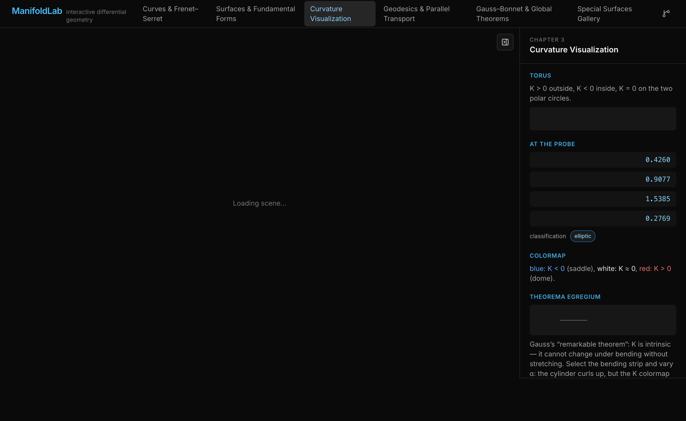
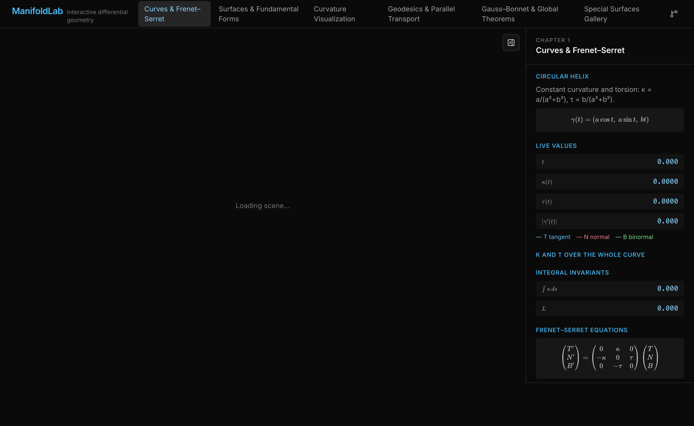
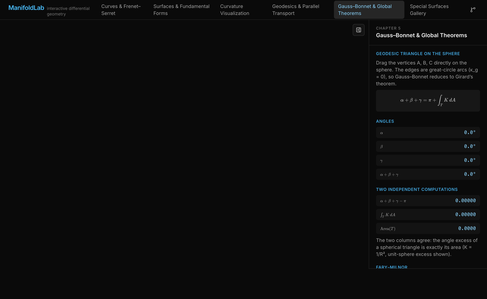

# ManifoldLab

**Interactive differential geometry in the browser** — curves, surfaces, curvature, geodesics and the great global theorems, every quantity computed live from the parametrizations.



## Chapters

1. **Curves & Frenet–Serret** — animated TNB frames (with rotation-minimizing fallback at inflections), live κ/τ plots, osculating circles and planes, arc-length reparametrization, knots (trefoil, figure-eight, torus knots, Viviani), total curvature and Fenchel/Fary–Milnor readouts.
2. **Surfaces & Fundamental Forms** — a parametric surface engine with a probe reading E, F, G / L, M, N, area element, tangent plane and normal field at any point of any catalog surface.
3. **Curvature Visualization** — real-time K and H colormaps (custom shader injection), point classification (elliptic/parabolic/hyperbolic/planar), principal direction fields, lines of curvature integrated on the surface, umbilic markers, Gauss map, and a Theorema-Egregium bending demo.
4. **Geodesics & Parallel Transport** — geodesic shooting from any point/direction (Christoffel-driven RK4), fan mode showing conjugate-point refocusing, parallel transport along latitude circles with holonomy readout, Clairaut conservation verified to ~10⁻¹³, and the κ² = κₙ² + κ_g² decomposition.
5. **Gauss–Bonnet & Global Theorems** — drag the vertices of a spherical geodesic triangle and watch α+β+γ−π agree with ∬K dA (computed independently via the solid-angle formula); total curvature ∬K dA = 2πχ integrated numerically; Willmore energy.
6. **Special Surfaces Gallery** — minimal-surface certificate (|H| ≈ 0) for catenoid/helicoid/Enneper/Scherk, the catenoid↔helicoid isometric deformation, cylinder unrolling (developables), Möbius-strip non-orientability walk, and a Klein bottle immersion.

| Curves | Gauss–Bonnet |
| --- | --- |
|  |  |

## Math core

`src/math/` is a framework-free TypeScript library (no React) with a vitest suite locking it to known analytic values:

- `differentiate.ts` — central-difference partial derivatives
- `ode.ts` — RK4 and adaptive RKF45 integrators
- `curve.ts` — arc-length reparametrization, Frenet frames, κ, τ, osculating circles, rotation-minimizing frames (double-reflection method)
- `surface.ts` — first/second fundamental forms, shape operator, principal curvatures/directions, Christoffel symbols from the metric, geodesic ODE, parallel transport, ∬K dA and Willmore integrators
- `catalog.ts` — named curves and surfaces (helix…Klein bottle)

Tests verify, among others: sphere K = 1/R², catenoid H = 0, helix κ/τ closed forms, torus K sign by region, great-circle closure, and latitude holonomy = 2π·cos(v₀).

## Stack

Vite 8 · React 19 · TypeScript 7 · Three.js + React Three Fiber 9 + drei · KaTeX · Tailwind CSS v4 · leva · zustand · pnpm

## Develop

```bash
nvm install        # Node LTS (see .nvmrc)
corepack pnpm || npm i -g pnpm
pnpm install
pnpm dev           # http://localhost:5173
```

## Verify

```bash
pnpm test          # vitest — math core against analytic values
pnpm typecheck     # tsc -b
pnpm build         # production build → dist/
pnpm preview       # serve the production build
```

## Deploy (Vercel)

`vercel.json` already contains the SPA rewrite. Either:

- import the GitHub repo at [vercel.com/new](https://vercel.com/new) — zero config, auto-deploys on every push, or
- `pnpm dlx vercel link && pnpm dlx vercel --prod` with the Vercel CLI.
