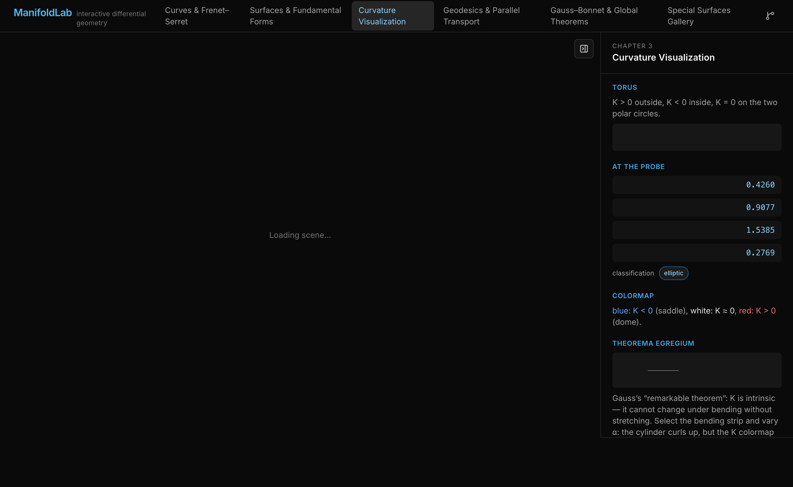
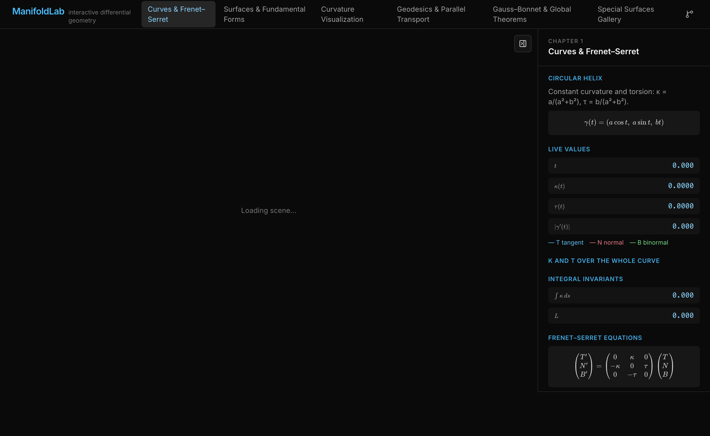
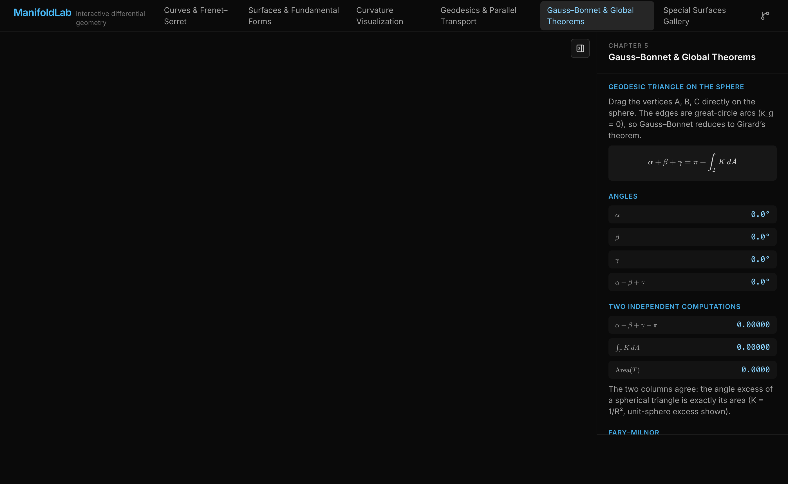

# ManifoldLab

### [→ Open the live lab (tap here)](https://sheungchakw.github.io/manifoldlab/)

**Poster / QR visitors:** this repository page is the source hub. The interactive product is the site above — open it in your browser (nothing to install).

[](https://sheungchakw.github.io/manifoldlab/)

Interactive differential geometry in the browser — curves and surfaces through Gauss–Bonnet, with quantities computed live as you drag the shape.



## Chapters

1. **Geometry of Curves** — regular and non-degenerate curves, arc-length, κ and τ, the Frenet–Serret frame, the fundamental theorem, and signed curvature k on a plane curve.
2. **Regular Surfaces** — local parametrizations, the tangent plane, level sets (including the cone, where ∇g = 0), and transition maps.
3. **Geometry of Euclidean Surfaces** — the first fundamental form g, the Gauss map ν, normal curvature k_n, K and H, Christoffel symbols, and the Theorema egregium.
4. **Gauss–Bonnet’s Theorem** — geodesics as curves with k_g = 0, a draggable curved triangle with exterior angles, and ∫_Σ K dS = 2πχ(Σ).

| Curves | Gauss–Bonnet |
| --- | --- |
|  |  |

## Math core

`src/math/` is a framework-free TypeScript library (no React) with a vitest suite locking it to known analytic values:

- `differentiate.ts` — central-difference partial derivatives
- `ode.ts` — RK4 and adaptive RKF45 integrators
- `curve.ts` — arc-length reparametrization, Frenet frames, κ, τ, osculating circles, rotation-minimizing frames (double-reflection method)
- `surface.ts` — first and second fundamental forms, principal curvatures, Christoffel symbols from g, the geodesic equation, and ∫ K dS
- `catalog.ts` — the curves and surfaces used in Chapters 1–3 (helix, circle, ellipse, sphere, torus, graphs, ellipsoid, cylinder, cone)

Tests verify, among others: sphere K = 1/R², helix κ and τ, and the sign of K on the torus.

## Stack

Vite 8 · React 19 · TypeScript 7 · Three.js + React Three Fiber 9 + drei · KaTeX · Tailwind CSS v4 · leva · zustand · pnpm

## Develop

```bash
nvm install        # Node LTS (see .nvmrc)
corepack pnpm || npm i -g pnpm
pnpm install
pnpm dev           # http://localhost:5173
```

## Verify

```bash
pnpm test          # vitest — math core against analytic values
pnpm typecheck     # tsc -b
pnpm build         # production build → dist/
pnpm preview       # serve the production build
```

## Deploy

Live site: [sheungchakw.github.io/manifoldlab](https://sheungchakw.github.io/manifoldlab/) (GitHub Pages).

Optional Vercel: `vercel.json` already contains the SPA rewrite — import the repo at [vercel.com/new](https://vercel.com/new) or `pnpm dlx vercel link && pnpm dlx vercel --prod`.
